  

  <picture>
    <source media="(prefers-color-scheme: light)" srcset="https://readme-typing-svg.demolab.com?font=JetBrains+Mono&amp;weight=500&amp;size=19&amp;duration=3200&amp;pause=900&amp;color=0E7490&amp;center=true&amp;vCenter=true&amp;width=820&amp;height=36&amp;lines=AI+Engineer+%C2%B7+Applied+Mathematics;RAG+%26+Agent+Systems;From+first+principles+to+production" />
    
  </picture>

  
  
  
  

## 01 · The short version

I'm an AI engineer based in Addis Ababa, Ethiopia. I build systems that turn messy data into decisions — LLM applications, retrieval pipelines, and computer vision products.

My work sits at the intersection of **applied mathematics** and **production AI**. I like to derive the math, implement the model from first principles, evaluate it honestly, and ship it behind a clean interface. Lately that means going deeper into linear algebra, optimization, and the calculus behind deep learning — then turning those ideas into tools people can actually use.

- **Building** — agentic RAG systems that combine graph and vector retrieval.
- **Studying** — optimization, probability, and the mathematics of modern ML.
- **Shipping** — AI applications with Python, FastAPI, Docker, and Gradio.

## 02 · Selected work

Four projects that show the range: the math underneath, the systems on top, and the products at the end.

  
  

  
  

  
    More work:
    <a href="https://github.com/tinsaeabreham45/fine_tune_bert">BERT sentiment at scale</a>
    (<a href="https://huggingface.co/spaces/TinsaeA/sentiment-analysis-demo">live demo</a>)
    · <a href="https://github.com/tinsaeabreham45/book_recommender">Emotion-aware book recommender</a>
    · <a href="https://github.com/tinsaeabreham45/potato_detection">Potato defect detection</a>
  

## 03 · Technical arsenal

The tools I reach for when an idea needs to become a working system.

  

  
  
  
  
  
  

## 04 · Momentum

Consistency compounds. A live snapshot of the work behind the repositories.

  

## 05 · Let's build

I'm open to **AI engineering roles**, **research collaborations**, and **ambitious LLM products**. If you're working on something that needs both rigor and shipping speed, let's talk.

  
  
  
  

  

  Designed &amp; built by Tinsae Abreham · 2026

